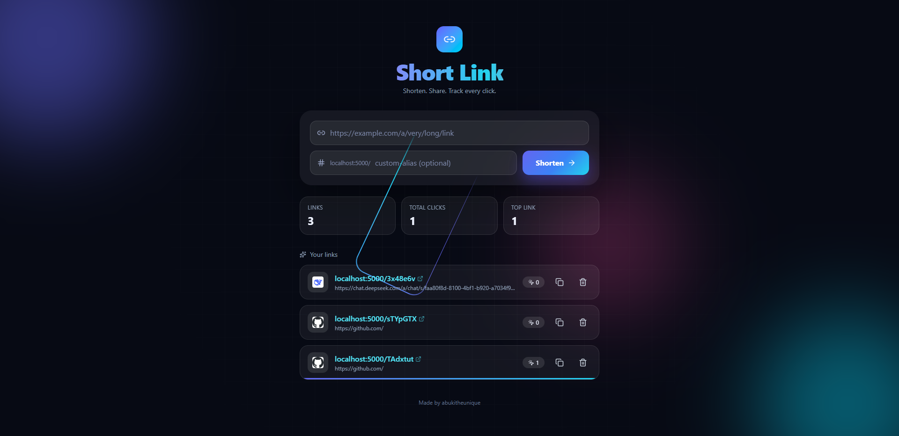

# Short Link: URL Shortener

Paste a long URL, get a short link you can share. Supports custom aliases, click counts, copy and delete.

**Live demo:** https://url-shortener-woad-psi.vercel.app

(The API runs on a free Render plan, so the first request after a pause can take up to a minute.)

## Features

- Shorten any http or https link
- Optional custom alias (3-30 letters, numbers, - or _)
- Click counter for each link
- Copy and delete from a personal list (each browser has its own anonymous ID)
- Input validation, reserved aliases, and rate limiting on the API

## Tech Stack

| Area | Tools |
| --- | --- |
| Frontend | React, Vite, Tailwind CSS, Lucide icons |
| Backend | Node.js, Express, express-rate-limit |
| Database | MongoDB Atlas with Mongoose |
| Hosting | Vercel (frontend), Render (API and redirects) |
| Quality | GitHub Actions CI |

## How it works

The React app calls the Express API to create links. Opening a short link hits the API, which looks up the code in MongoDB, adds one to the click count, and redirects with a 302.

## Run locally

~~~bash
git clone https://github.com/abukitheunique/url-shortener.git
cd url-shortener/server
npm install
~~~

Create `server/.env`:

~~~
MONGO_URI=your_mongodb_connection_string
PORT=5000
BASE_URL=http://localhost:5000
~~~

~~~bash
npm run dev
~~~

In a second terminal:

~~~bash
cd client
npm install
npm run dev
~~~

Open http://localhost:5173.

## Author

Built by [abukitheunique](https://github.com/abukitheunique).
